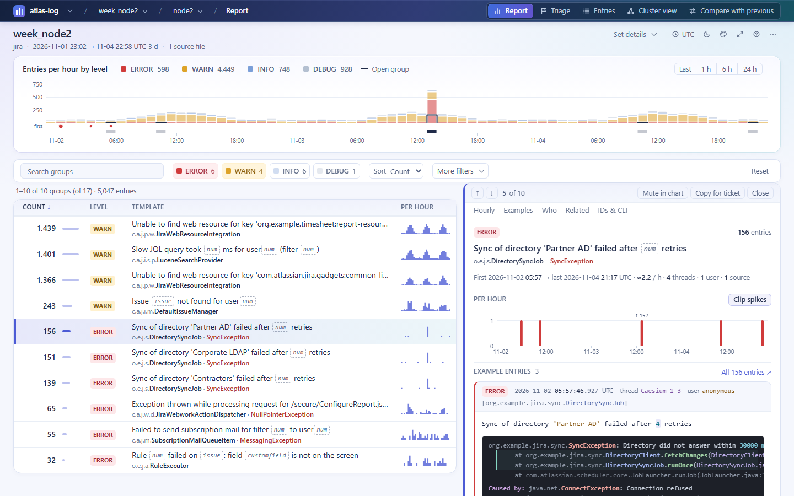
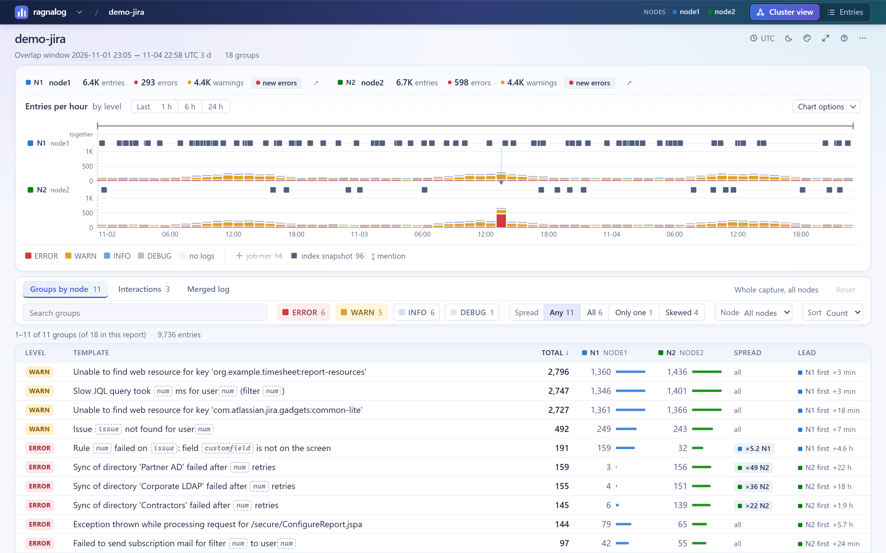
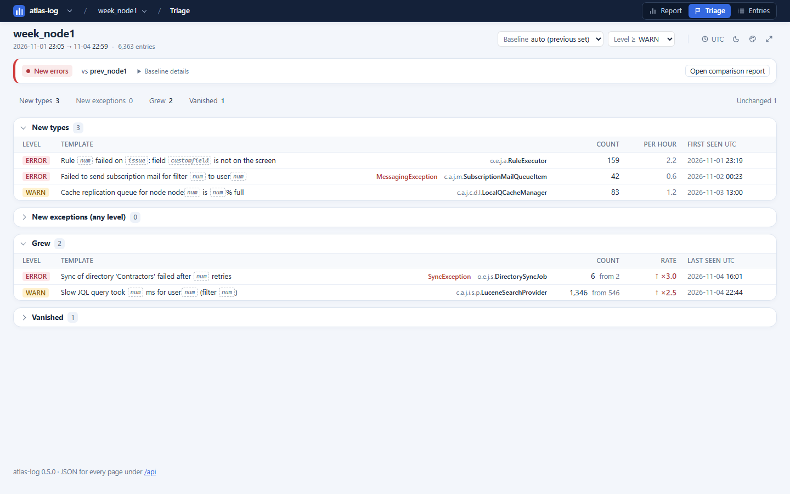
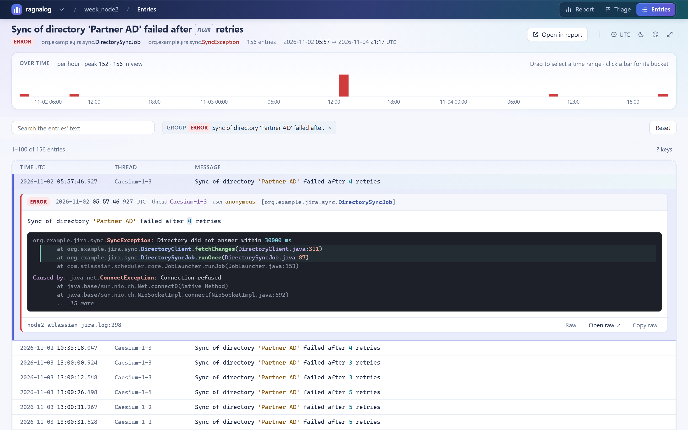

<div align="center">


# Ragnalog

**Atlassian Data Center log analyzer for the end days. Forget Grafana/Loki, this is the best log viewer vibecoded this week!**

[](https://github.com/rdk/ragnalog/releases/latest)
[](https://www.python.org/)
[](https://docs.astral.sh/uv/)
[](https://github.com/rdk/ragnalog/pkgs/container/ragnalog)
[](docs/formats/)
[](https://docs.astral.sh/ruff/)
[](LICENSE)

[Quick start](#quick-start) · [Features](#features) · [Web app](#web-app) · [CLI](#cli) · [For agents](#for-agents) · [How it works](#how-it-works) · [Docs](#documentation)

<br>

<a href="docs/img/hero-light.png"><picture>
  <source media="(prefers-color-scheme: dark)" srcset="docs/img/hero-dark.png">
  
</picture></a>

</div>

## Features

- **Groups instead of lines.** Every entry gets a stable signature (level, logger, masked
  message, exception chain), so millions of lines become a few hundred groups with counts,
  time span, users and threads.
- **Triage in one look.** New kinds of errors, groups that grew and groups that vanished
  against the previous log set, with a verdict per set and per cluster node.
- **Cluster view.** The nodes of a cluster side by side on one time axis, with events, the
  moments several nodes fail together, groups by node and the merged log.
- **Variables kept.** Issue keys, numbers, ids and URLs are masked out of the template but
  stored per entry, so you can still ask *which* issues or users were hit.
- **Stack traces made readable.** Frames are tokenised and coloured, library frames dimmed
  and your application's own frames marked.
- **Every entry of a group.** A filterable, bookmarkable table of all entries of one group,
  with a time histogram to cut a window.
- **Works offline.** `report` writes one self-contained HTML file you can mail or keep.
- **JSON-first CLI.** Every command prints a documented JSON document when piped, with
  stable exit codes and a manifest written for agents.
- **SQL when you need it.** `query` runs DuckDB over the stored Parquet entries and groups.

<a href="docs/img/drawer.png"></a>

<sub><b>Group panel:</b> facts, hourly chart and example entries with stack traces.</sub>

<a href="docs/img/cluster.png"></a>

<sub><b>Cluster view:</b> two nodes on one time axis, with events and groups by node.</sub>

<a href="docs/img/triage.png"></a>

<sub><b>Triage:</b> what is new, what grew and what vanished since the previous set.</sub>

<a href="docs/img/entries.png"></a>

<sub><b>Entries:</b> every entry of a group, with a time histogram and the full entry inline.</sub>

## Quick start

Pick one: the **Docker image** runs the web app with nothing else installed; **without
Docker** you get the `ragnalog` command (CLI and web app) on your machine.

### With Docker

The image is published to the GitHub Container Registry with each release; pulling it
needs no sign-in.

Run the web app on port 8321 with its data directory (where the log sets are kept) in a
named volume. Whoever reaches the port can read, upload and delete log sets, so publish it
on this machine only and give the app a token:

```sh
export RAGNALOG_TOKEN="$(openssl rand -hex 16)"
docker run -d --name ragnalog -p 127.0.0.1:8321:8321 -v ragnalog:/data \
  -e RAGNALOG_TOKEN ghcr.io/rdk/ragnalog:0.6.1
echo "http://localhost:8321/?token=$RAGNALOG_TOKEN"      # open once; the token is kept
```

In PowerShell, set the token with `$env:RAGNALOG_TOKEN = [guid]::NewGuid().ToString("N")`
and put `docker run` on one line. To serve other machines, publish `-p 8321:8321`; the
token then guards it alone.

Upload log files on the start page, or ingest a folder with the CLI from the same image
(any `ragnalog` command works this way):

```sh
docker run --rm -v ragnalog:/data -v "$PWD/logs:/in:ro" \
  ghcr.io/rdk/ragnalog:0.6.1 ingest /in --name prod-1030
```

The container runs as user 10001. On Linux it can read only files that others may read:
logs taken from a Jira server are often readable by its own user alone, so copy them into
a folder of yours (or `chmod -R o+rX logs`).

**Upgrading:** the log sets stay in the volume. Remove the container
(`docker rm -f ragnalog`) and run the same `docker run` with the new tag. When the release
notes say signatures changed, older sets show as stale; rebuild them with
`docker exec ragnalog ragnalog upgrade --all`.

<details>
<summary>Docker Compose</summary>

```yaml
services:
  ragnalog:
    image: ghcr.io/rdk/ragnalog:0.6.1
    ports: ["127.0.0.1:8321:8321"]
    environment:
      RAGNALOG_TOKEN: ${RAGNALOG_TOKEN:?set a token}
    volumes: ["ragnalog:/data"]
    restart: unless-stopped
volumes:
  ragnalog:
```

Keep the token in a `.env` file beside it (`RAGNALOG_TOKEN=...`), start with
`docker compose up -d`, and ingest with
`docker compose run --rm -v "$PWD/logs:/in:ro" ragnalog ingest /in --name prod-1030`.
To upgrade, change the tag and run `docker compose up -d` again.

</details>

To build the image yourself: `docker build -t ragnalog .`

### Without Docker

You need [uv](https://docs.astral.sh/uv/getting-started/installation/); it fetches
Python 3.14 itself. Install a release straight from GitHub (`[web]` adds the web app,
`[mine]` the optional Drain3 template mining):

```sh
uv tool install "ragnalog[web] @ git+https://github.com/rdk/ragnalog.git@v0.6.1"
ragnalog --version
```

or install the wheel attached to the release:

```sh
uv tool install "ragnalog[web] @ https://github.com/rdk/ragnalog/releases/download/v0.6.1/ragnalog-0.6.1-py3-none-any.whl"
```

Then choose a data directory, the folder that keeps the log sets (outside any git
repository; the option and variable that name it are `--store` and `RAGNALOG_STORE`),
ingest some logs and open the web app:

```sh
export RAGNALOG_STORE=~/ragnalog-data
ragnalog ingest /var/atlassian/application-data/jira/log/ --name prod-1030
ragnalog serve                                   # http://127.0.0.1:8321/
```

### From source

```sh
git clone git@github.com:rdk/ragnalog.git && cd ragnalog
uv sync --all-extras --dev                       # .venv with every extra and the dev tools
uv run ragnalog --help
```

### Try it with demo logs

No logs at hand? Generate the synthetic two-node cluster the screenshots use:

```sh
uv run python scripts/demo_logs.py /tmp/demo     # two weeks, two nodes, invented data
uv run ragnalog --store /tmp/demo-data ingest /tmp/demo/prev --cluster demo-jira --name prev
uv run ragnalog --store /tmp/demo-data ingest /tmp/demo/week --cluster demo-jira --name week
uv run ragnalog --store /tmp/demo-data serve
```

## Web app

`ragnalog serve` (or the container) serves:

| Page | What it shows |
|---|---|
| **Log sets** `/` | searchable by name, node, cluster or ID, with error counts, activity and a verdict against the previous set; matching captures keep their nodes together; upload with progress |
| **Report** `/sets/SET` | entries per hour by level, filterable groups, the group panel with examples, stack traces and related groups |
| **Triage** `/sets/SET/triage` | new types (ERROR first), grown and vanished groups against a baseline it picks or you choose |
| **Entries** `/sets/SET/entries?signature=…` | all entries of a group or filter, with a time histogram, opened from the group panel |
| **Cluster view** `/captures/CAPTURE` | the nodes side by side, cross-node moments, interactions and the merged log |

Everything is also JSON under `/api` (OpenAPI at `/docs`), the same documents the CLI prints.
Light and dark themes, UTC or local time, keyboard shortcuts (`?`), and the view lives in
the URL, so a link reopens the same filters. See [`docs/webapp.md`](docs/webapp.md).
The palette button beside the theme toggle offers **Aurora** (violet/cyan, the default),
**Classic** and **Mineral** (ivory/sage) skins. Your choice is remembered across pages, works with
either light or dark mode, and is also available in exported HTML reports.

## CLI

```sh
ragnalog ingest logs/ --name prod-1030                         # build a log set
ragnalog triage prod-1030                                      # new kinds of errors vs the previous set?
ragnalog groups prod-1030 --min-level WARN --brief             # one row per group
ragnalog show prod-1030 83d1828c --brief                       # entries of a group (signature prefix)
ragnalog frames prod-1030 83d1828c                             # its stack trace, application frames first
ragnalog context prod-1030 ENTRY_ID --before 10                # what the thread did around one entry
ragnalog diff prod-1029 prod-1030 --rate --limit 20            # new / vanished / changed vs an earlier set
ragnalog report prod-1030 --compare prod-1029 --out r.html     # one self-contained HTML file
ragnalog ingest jira-logs_export.zip --cluster jira-prod       # cluster export: one set per node
ragnalog capture cluster:jira-prod                             # the nodes side by side, a verdict each
ragnalog query prod-1030 "select level_name, count(*) from entries group by 1"
```

A set is referred to by name, id or unique id prefix. Sets are kept in a data directory:
`--store DIR`, else `$RAGNALOG_STORE`, else `./.ragnalog` (never created inside a git
work tree, so real logs cannot end up in a repository). Full reference:
[`docs/cli.md`](docs/cli.md).

## For agents

Every command prints JSON when stdout is not a terminal (`"schema": "<name>.v1"`, rows in
`"items"`), with stable exit codes (`0` ok, `1` usage, `2` nothing found, `3` data directory
error) and an `error.v1` document with a `hint` on failure. Start with the manifest, about
10 KB of JSON describing the workflow and every command:

```sh
ragnalog manifest                                    # how to use the tool (manifest.v1)
ragnalog triage today                                # verdict vs the previous set
ragnalog groups today --min-level ERROR --brief      # check "total" / "truncated"
printf '%s\n' '["groups","today","--brief"]' '["show","today","83d1"]' | ragnalog batch
```

`batch` runs many commands in one process (one JSON document per line). The workflow,
conventions and a cookbook of common questions are in [`docs/agents.md`](docs/agents.md).

## How it works

`ragnalog` reads `atlassian-jira.log` files (rotated and gzipped ones too, ZIP exports,
Java stack traces) into a **log set**. Each entry is masked (issue keys, numbers, ids, URLs,
users, IPs become placeholders such as `<ISSUE>`) and gets a signature from its level,
logger, masked message and exception chain; entries with the same signature form a
**group**. Signatures are stable across sets, so two sets (before and after an upgrade, two
nodes, two days) compare without the raw logs.

```
<data directory>/<logset-id>/
├── manifest.json      logset.v1: sources, time range, counts, versions
├── entries.parquet    one row per entry (with its variables)
├── groups.parquet     one row per signature
└── merges.parquet     Drain3 merge proposals (optional)
```

The Parquet files read directly in DuckDB, polars or pandas. Design notes:
[`docs/design.md`](docs/design.md).

## Documentation

| | |
|---|---|
| [`docs/cli.md`](docs/cli.md) | command reference: options, JSON output, exit codes, environment variables |
| [`docs/webapp.md`](docs/webapp.md) | web app pages and the HTTP API |
| [`docs/report.md`](docs/report.md) | the report page, the HTML file and its `report.v1` payload |
| [`docs/cluster.md`](docs/cluster.md) | captures and the cluster view |
| [`docs/agents.md`](docs/agents.md) | agent workflow, conventions and cookbook |
| [`docs/design.md`](docs/design.md) | architecture, models, storage format |
| [`docs/formats/`](docs/formats/) | every document and stored table, with JSON Schemas |
| [`CHANGELOG.md`](CHANGELOG.md) | release notes |

## Development

```sh
uv sync --all-extras --dev
uv run ruff check . && uv run ruff format --check . && uv run mypy && uv run pytest
```

`pytest` includes browser smoke tests of every page on the demo logs (`tests/browser`; they
skip without Node 22+ and Edge or Chrome). CI does not run on pushes; the release workflow
runs the same checks on Ubuntu and Windows before it publishes a tag (see
[`RELEASING.md`](RELEASING.md)), and `scripts/screenshots.mjs` refreshes the README images
from the demo logs. [`AGENTS.md`](AGENTS.md) is the guide for coding agents (and humans)
working on the code: layout, conventions and data hygiene. Fixtures are small, hand-masked
excerpts; real logs never enter the repository.

## License

[Apache License 2.0](LICENSE) © 2026 Radoslav Krivák
