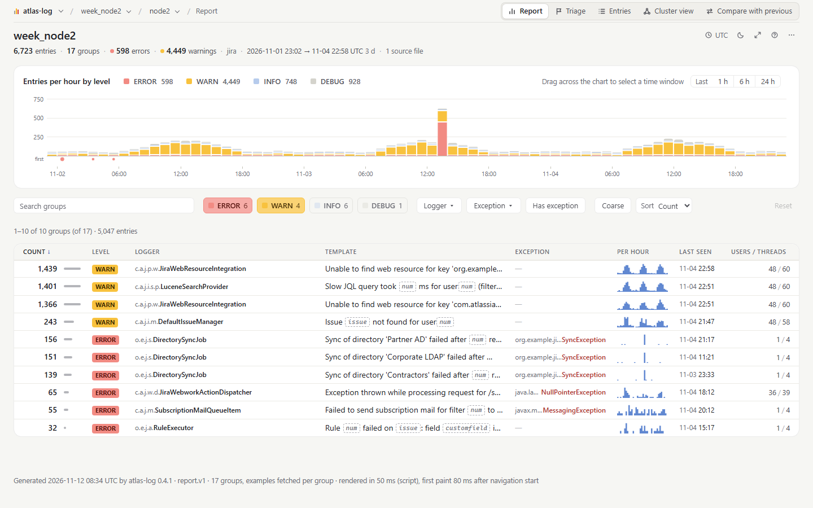
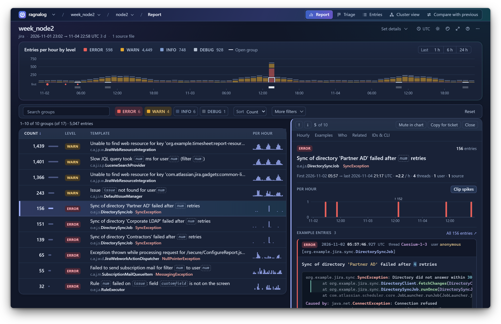
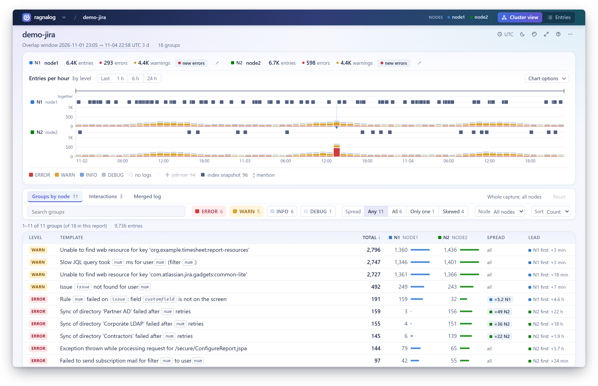
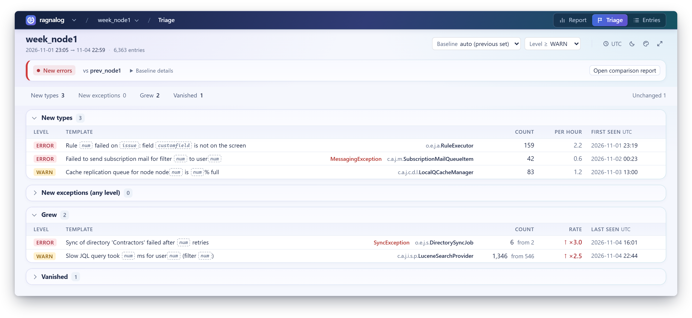
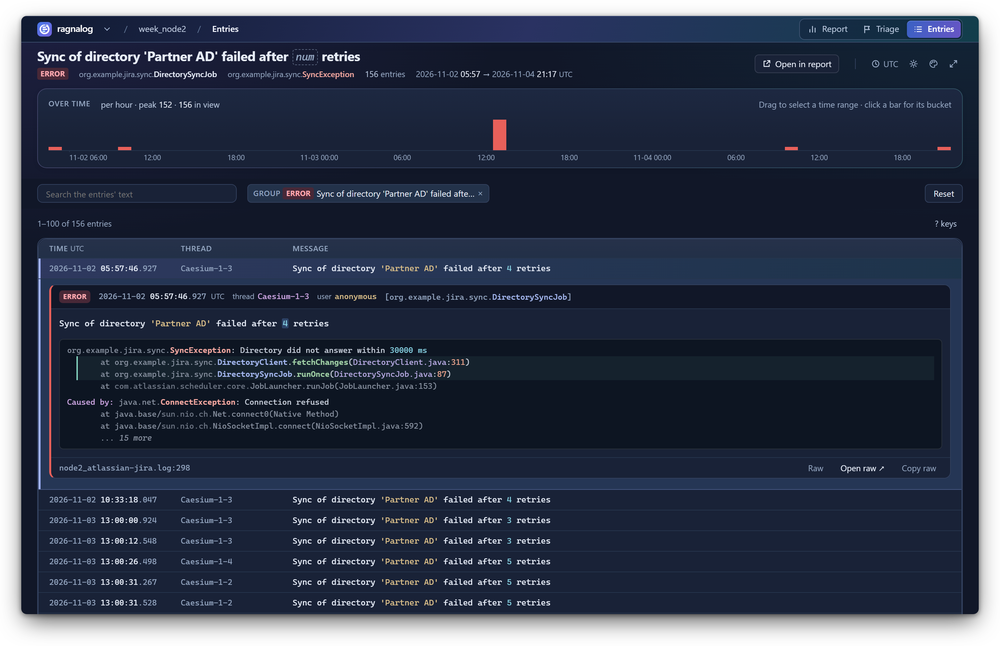

<h1 align="center"><br>Ragnalog</h1>

<div align="center">

**Atlassian Data Center log analyzer for the end days. Forget Grafana/Loki, this is the best log viewer vibecoded this week!**

Ragnalog folds millions of Jira Data Center log lines into a few hundred groups and shows
which errors are new, growing or gone since the previous logs, node by node. It runs on
your machine as a web app, a JSON CLI and single-file HTML reports, and it is
[agent-friendly](#for-agents).

[](https://github.com/rdk/ragnalog/releases/latest)
[](https://github.com/rdk/ragnalog/actions/workflows/ci.yml)
[](https://www.python.org/)
[](https://github.com/rdk/ragnalog/pkgs/container/ragnalog)
[](#scope)
[](LICENSE)

[Quick start](#quick-start) · [Features](#features) · [Scope](#scope) · [Web app](#web-app) · [CLI](#cli) · [For agents](#for-agents) · [How it works](#how-it-works) · [Docs](#documentation)

<a href="docs/img/hero-light.png"><picture>
  <source media="(prefers-color-scheme: dark)" srcset="docs/img/hero-dark.png">
  
</picture></a>

</div>

## Quick start

**Docker** runs the web app with nothing else installed. The token in `ragnalog.env` keeps
out anyone else who reaches the port:

```sh
(umask 077; echo "RAGNALOG_TOKEN=$(openssl rand -hex 16)" > ragnalog.env)
docker run -d --name ragnalog -p 127.0.0.1:8321:8321 -v ragnalog:/data \
  --env-file ragnalog.env ghcr.io/rdk/ragnalog:0.6.1
echo "http://localhost:8321/?token=$(cut -d= -f2 ragnalog.env)"
```

Open the printed address and drop a support zip, a cluster log export or log files on the
start page.

**Without Docker**, install the `ragnalog` command (CLI and web app) with
[uv](https://docs.astral.sh/uv/getting-started/installation/), which brings Python 3.14.
It is not on PyPI, so install the release wheel:

```sh
uv tool install "ragnalog[web] @ https://github.com/rdk/ragnalog/releases/download/v0.6.1/ragnalog-0.6.1-py3-none-any.whl"
export RAGNALOG_STORE=~/ragnalog-data            # the data directory: where log sets are kept
ragnalog ingest Jira_support_2026-10-30.zip --name prod-1030
ragnalog serve                                   # http://127.0.0.1:8321/
```

PowerShell, Compose, upgrades, a source checkout and demo logs:
[`docs/install.md`](docs/install.md).

## Features

- **Groups instead of lines.** Each entry gets a stable signature (level, logger, masked
  message, exception chain), so millions of lines become a few hundred groups with counts,
  time span, users and threads.
- **Triage.** New kinds of errors, grown groups and vanished groups against the previous
  log set, with a verdict per set and per node.
- **Cluster view.** All nodes on one time axis: events, moments when several nodes fail
  together, groups by node and the merged log.
- **Variables kept.** Issue keys, numbers, IDs and URLs are masked for grouping but stored
  per entry, so you can still ask *which* issues or users were hit.
- **Readable stack traces.** Frames are tokenised and coloured, library frames dimmed and
  your own frames marked.
- **All entries of a group** in a filterable, bookmarkable table with a time histogram.
- **Offline reports.** `report` writes one self-contained HTML file to attach to a ticket.
- **JSON-first CLI** with documented output, stable exit codes and a manifest for agents.
- **SQL** over the stored entries and groups with `query` (DuckDB on Parquet).

<table>
<tr>
<td width="50%" valign="top">
<a href="docs/img/drawer-dark.png"></a>
<br><sub><b>Group panel:</b> facts, hourly chart and example entries with stack traces.</sub>
</td>
<td width="50%" valign="top">
<a href="docs/img/cluster-light.png"></a>
<br><sub><b>Cluster view:</b> two nodes on one time axis, with events and groups by node.</sub>
</td>
</tr>
<tr>
<td width="50%" valign="top">
<a href="docs/img/triage-light.png"></a>
<br><sub><b>Triage:</b> what is new, grown or gone since the previous set.</sub>
</td>
<td width="50%" valign="top">
<a href="docs/img/entries-dark.png"></a>
<br><sub><b>Entries:</b> all entries of a group, with a time histogram and the full entry inline.</sub>
</td>
</tr>
</table>

## Scope

- **Reads** Jira Data Center's `atlassian-jira.log`: rotated and gzipped files, support
  zips, and cluster log exports (one log set per node).
- **Skips** access, GC and JSON logs and the `-security`, `-outgoing-mail` and
  `-slow-queries` side logs, and lists what it skipped.
- **Not yet:** Confluence, Bitbucket and other products; log formats are pluggable
  ([`docs/design.md`](docs/design.md)).
- **After the fact:** it analyses the files you give it; no tailing, shipping or alerts.
- **Local:** no telemetry and no outbound requests, HTML reports included.
- **Raw text kept:** masking is for grouping, not anonymisation. The data directory and the
  HTML reports hold the original log text; share them as you would the logs.
- **Speed:** 191 MB of logs (712k entries) ingest in about 18 s.

A **log set** is one node's logs, ingested together. A **capture** is the log sets of a
cluster's nodes collected together, such as one cluster log export.

## Web app

`ragnalog serve` (or the container) serves:

| Page | Shows |
|---|---|
| **Log sets** `/` | every set with error counts, activity and a verdict against the previous set, a capture's sets together; search and upload |
| **Report** `/sets/SET` | entries per hour by level, filterable groups, and a group panel with examples, stack traces and related groups |
| **Triage** `/sets/SET/triage` | new types (ERROR first), grown and vanished groups against a baseline it picks or you choose |
| **Entries** `/sets/SET/entries?signature=…` | all entries of a group or filter, with a time histogram |
| **Cluster view** `/captures/CAPTURE` | the nodes side by side, cross-node moments, interactions and the merged log |

Every page has a JSON twin under `/api` (OpenAPI at `/docs`): the same documents the CLI
prints. Light and dark themes, times in your time zone or UTC, and keyboard shortcuts (`?`);
filters live in the URL, so a link reopens the same view. More in [`docs/webapp.md`](docs/webapp.md).

## CLI

```sh
ragnalog ingest logs-1029/ --name prod-1029                    # build a log set
ragnalog ingest logs-1030/ --name prod-1030                    # and a later one
ragnalog triage prod-1030                                      # new kinds of errors vs prod-1029?
ragnalog groups prod-1030 --min-level WARN --brief             # one row per group
ragnalog show prod-1030 83d1828c --brief                       # entries of a group (signature prefix)
ragnalog frames prod-1030 83d1828c                             # its stack trace, application frames first
ragnalog context prod-1030 ENTRY_ID --before 10                # what the thread did around one entry
ragnalog diff prod-1029 prod-1030 --rate --limit 20            # new, vanished and changed groups
ragnalog report prod-1030 --compare prod-1029 --out r.html     # one self-contained HTML file
ragnalog ingest jira-logs_export.zip --cluster jira-prod       # cluster export: one set per node
ragnalog capture cluster:jira-prod                             # the nodes side by side, a verdict each
ragnalog query prod-1030 "select level_name, count(*) from entries group by 1"
```

Against a ragnalog web app instead of a local data directory: set `RAGNALOG_SERVER` (and
`RAGNALOG_TOKEN`) and the same commands ask its `/api` ([remote mode](docs/cli.md#remote-mode---server)).
Refer to a set by name, ID or unique ID prefix. Sets live in the data directory:
`--store DIR`, else `$RAGNALOG_STORE`, else `./.ragnalog`, which is never created inside a
git work tree, so real logs stay out of repositories. Reference: [`docs/cli.md`](docs/cli.md).

## For agents

An agent can drive ragnalog as well as a person can. When stdout is not a terminal, every
command prints JSON (`"schema": "<name>.v1"`, rows in `"items"`, and on failure an
`error.v1` document with a `hint`). Exit codes: `0` ok, `1` usage, `2` nothing found or
parsed, `3` data directory error such as an unknown set. Start with the manifest, about 10
KB describing the workflow and every command; `batch` runs many commands in one process:

```sh
ragnalog manifest                                    # how to use the tool (manifest.v1)
printf '%s\n' '["groups","today","--brief"]' '["show","today","83d1"]' | ragnalog batch
```

Workflow, conventions and a cookbook of common questions: [`docs/agents.md`](docs/agents.md).

## How it works

`ragnalog` reads `atlassian-jira.log` files, Java stack traces included, into a **log set**.
Each message is masked for grouping (issue keys, numbers, IDs, URLs, users and IPs become
placeholders such as `<ISSUE>`; the values are kept per entry), and each entry gets a
signature from its level, logger, masked message and exception chain. Entries with the same
signature form a **group**. Signatures are stable across sets, so sets from before and after
an upgrade, from two nodes or from two days compare without the raw logs.

```
<data directory>/<logset-id>/
├── manifest.json      logset.v1: sources, time range, counts, versions
├── entries.parquet    one row per entry, with its raw text and variables
├── groups.parquet     one row per signature
└── merges.parquet     Drain3 merge proposals (optional)
```

The Parquet files open directly in DuckDB, polars or pandas. Design notes:
[`docs/design.md`](docs/design.md).

## Documentation

Guides:

- [`docs/install.md`](docs/install.md): Docker, the `ragnalog` command, source checkout and demo logs
- [`docs/cli.md`](docs/cli.md): every command, its options, JSON output, exit codes and environment variables
- [`docs/webapp.md`](docs/webapp.md): web app pages, settings and the HTTP API
- [`docs/agents.md`](docs/agents.md): agent workflow, conventions and cookbook
- [`docs/formats/`](docs/formats/): every JSON document and stored table, with JSON Schemas

Design notes, written as the features were built:

- [`docs/design.md`](docs/design.md): architecture, models and storage format
- [`docs/report.md`](docs/report.md): the report page, the HTML file and its `report.v1` payload
- [`docs/cluster.md`](docs/cluster.md): captures and the cluster view

Release notes: [`CHANGELOG.md`](CHANGELOG.md).

## Contributing

Issues and pull requests are welcome. [`CONTRIBUTING.md`](CONTRIBUTING.md) covers the
checks, the screenshots and how to report a parsing problem without sharing real logs.

## License

[Apache License 2.0](LICENSE) © 2026 Radoslav Krivák
