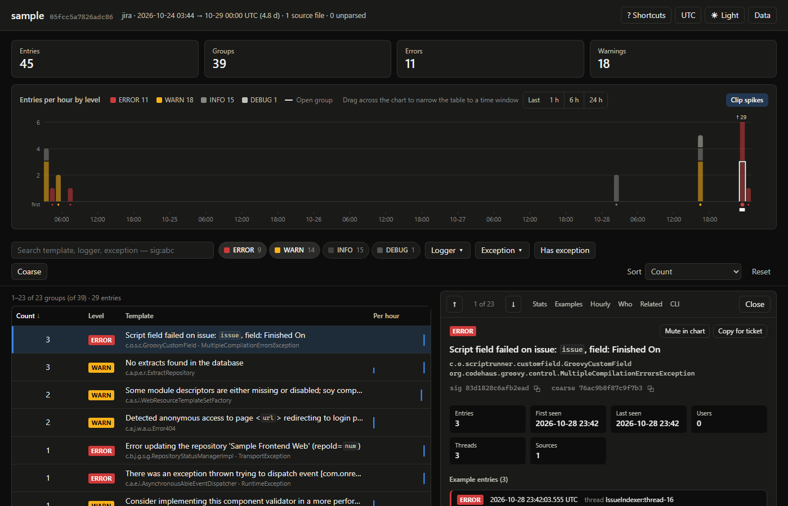

# atlas-log-analyzer

Parse, group and compare application log files — Jira Data Center first.

**Status:** 0.1 — Jira Data Center format.

## What you get

- **Groups instead of lines** — every entry gets a stable signature (level,
  logger, masked message, exception chain); millions of lines become a few
  hundred groups with counts, time span, users and threads.
- **Variables kept** — issue keys, numbers, ids and URLs are masked out of the
  template but stored per entry, so you can ask *which* values occur.
- **Before/after diffs** — `diff` shows new, vanished and changed groups
  between two log sets (upgrade, node, day) without the raw logs.
- **SQL on Parquet** — `query` runs DuckDB over the stored entries and groups.
- **One-file HTML report** and a **JSON-first CLI** with documented schemas
  and exit codes for scripts and agents.
- **Web app** — `atlas-log serve` lists the sets with a verdict against the
  previous one ("160 new error types"), opens the report, and ingests uploads.

`atlas-log` turns `atlassian-jira.log` files (including rotated ones and Java
stack traces) into a **log set**: Parquet tables of entries and of *groups*,
where a group collects all entries with the same level, logger, masked message
and exception chain. Variable parts (issue keys, numbers, ids, URLs …) are
masked out of the group template and kept per entry as `variables`. Group
signatures are stable hashes, so two log sets — before and after an upgrade,
two nodes, two days — can be compared without the raw logs.

Built for humans at a terminal and for coding/ops agents: every command
prints JSON when piped, with documented schemas and exit codes.

## Install

Requires Python 3.14 and [uv](https://docs.astral.sh/uv/).

```sh
uv tool install .           # install the `atlas-log` command
uv tool install '.[mine]'   # with the optional Drain3 template mining
uv tool install '.[web]'    # with the web app (atlas-log serve)
atlas-log --help

uv sync --all-extras --dev  # development environment (.venv)
uv run atlas-log --help
```

## Quick start (humans)

```sh
export ATLAS_LOG_STORE=~/atlas-log-store                       # where log sets live
atlas-log ingest /var/atlassian/jira/log/ --name prod-1029     # build a log set
atlas-log groups prod-1029 --min-level WARN                    # one row per signature
atlas-log show prod-1029 83d1828c6afb2ead                      # entries of a group, with variables
atlas-log show prod-1029 83d1828c6afb2ead --raw --limit 1      # the original text
atlas-log ingest ./logs-after-upgrade/ --name prod-1030
atlas-log diff prod-1029 prod-1030 --level ERROR               # new / vanished / changed groups
```

Log sets live in `--store DIR`, else `$ATLAS_LOG_STORE`, else `./.atlas-log`.
The implicit `./.atlas-log` is not created inside a git work tree (a store in a
repository risks committing real logs): `ingest` then stops with a
`store_error` and asks for `--store` or `ATLAS_LOG_STORE`; an existing
`./.atlas-log` keeps working. A set can be referred to by id, name or unique id
prefix.

## Report

```sh
atlas-log report prod-1030 --compare prod-1029 --out prod-1030.html --open
```

writes one self-contained HTML file (no network access needed; open it from a
file share or send it by e-mail): timeline by level, filterable group table,
per-group drawer with example entries, stack traces and the matching CLI
commands, and — with `--compare` — new / vanished / changed groups against a
baseline. The view (filters, selected group) is kept in the URL, so a link
with its `#…` part reopens the same view. See `docs/report.md`.



<!-- Screenshot placeholder: docs/img/report.png must be made from a fixture
     (e.g. tests/fixtures/jira/sample.log), never from real logs. -->

## Web app

```sh
atlas-log --store ~/atlas-log-store serve   # http://127.0.0.1:8321/
```

The start page lists every set with its error counts and a triage verdict
against the previous set. **Triage** shows the new types first (ERROR before
WARN), then groups whose hourly rate grew, then vanished ones, each linking into
the report with the group open. **Upload** ingests log files in the background
with a progress bar. Everything is also JSON under `/api` (OpenAPI at `/docs`);
`GET /api/sets/SET/triage` answers "any new kinds of errors?" in one call — the
same `triage.v1` document as `atlas-log triage SET`. See `docs/webapp.md`.

## Agent workflow

```sh
atlas-log ingest LOGS/ --name today                         # 1. build the set (JSON manifest)
atlas-log triage today                                      #    verdict vs the previous set
atlas-log groups today --min-level ERROR --limit 20 --brief # 2. triage: check "total"/"truncated"
atlas-log show today SIGNATURE --limit 5                    # 3. drill into one group
atlas-log frames today SIGNATURE                            #    its stack trace, plugin frames first
atlas-log entries today --signature SIGNATURE --since 2h --raw   # 4. read the raw text
atlas-log context today ENTRY_ID --before 10                # 5. what the thread did around it
atlas-log entries today --request-id REQUEST_ID --brief     # 6. the whole HTTP request
```

Repeat 2–6; on an error, read `error.hint` for the next step.

## Quick start (agents)

- Set `ATLAS_LOG_STORE` (or pass `--store DIR`) to a directory outside any
  repository; the implicit `./.atlas-log` is refused inside a git work tree.
- Output is JSON whenever stdout is not a terminal; force it with
  `--output json` (one document) or `--output jsonl` (one row per line).
- Every document has `"schema": "<name>.v1"`; listings put rows in `"items"`.
- `groups` and `entries` page with `--limit N --offset M`: `"truncated": true`
  means more rows follow; fetch the next page with `--offset <offset + count>`.
- Keep rows small: `--brief` (a documented column preset) or
  `--columns a,b,c` on `groups` and `entries`.
- Level filters hide DEBUG stack traces; `--with-exception` (any level with an
  exception) and `--exception TEXT` (substring of `exception_type`) do not.
- `frames SET SIGNATURE|ENTRY_ID` reduces a stack trace to its application
  frames (JDK and Jira platform packages skipped; set `ATLAS_LOG_APP_PACKAGES=
  com.acme.,org.example.` to name your own packages instead).
- Errors: `{"schema": "error.v1", "error": {"code": ..., "message": ...}}` on
  stdout; exit codes `0` ok, `1` usage, `2` nothing found / parse failure,
  `3` store error. Diagnostics go to stderr (`--quiet` silences them).
- Long entries are cut in JSON: `raw` and `body` keep 4000 characters
  (`--max-raw N`, `0` = all); cut rows carry `"body_truncated": true` and
  `"raw_chars"`. `--raw` (plain text) is never cut unless `--max-raw` is given.
- `atlas-log schema` describes the stored tables (`entries`, `groups`,
  `merges`, `logset`) field by field; `atlas-log COMMAND --help` documents the
  JSON shape and exit codes of each command.

```sh
atlas-log --output json ingest atlassian-jira.log --name today
atlas-log groups today --min-level ERROR --limit 20 | jq '.items[] | {signature, count, template}'
atlas-log query today "select level_name, count(*) n from entries group by 1 order by 2 desc"
atlas-log query today "select unnest(variables) v, count(*) n from entries
                       where signature = '83d1828c6afb2ead' group by 1 order by 2 desc"
atlas-log query today "select hour(ts) h, count(*) from entries where level >= 50 group by 1 order by 1"
atlas-log parse atlassian-jira.log --limit 100      # JSONL entries, no store
```

`query --help` lists the columns of the `entries`, `groups` and `merges`
views; a misspelt column gets the candidate columns in `error.hint`.

## Agent cookbook

Five common questions and the commands that answer them. `before`/`after` are
set names given at `ingest --name`; `SIG` is a 16-hex group signature from
`groups`, `ENTRY` an entry id from `entries`/`show`, `REQ` a Jira request id.

**1. What broke after the deploy?**

```sh
atlas-log triage after --baseline before            # verdict, new types, new exceptions, growth
atlas-log diff before after --min-level WARN --rate # full comparison, changed groups by hourly rate
```

Read `verdict`, then `new` and `new_exceptions` (stack traces below the level
filter). If `warnings` is not empty the two sets cover very different spans
and `new`/`vanished` are unreliable: compare sets of similar length.

**2. What is in this stack trace?**

```sh
atlas-log frames after SIG                          # the chain with application frames first
atlas-log frames after SIG --all                    # every frame, with an "app" flag
atlas-log show after SIG --raw --limit 1 --max-raw 0   # the full original text of one entry
```

**3. Which request or thread triggered it?**

```sh
atlas-log entries after --signature SIG --columns id,ts,thread,user,request_id --limit 5
atlas-log entries after --request-id REQ --brief    # everything that request logged
atlas-log context after ENTRY --before 20           # what the thread did just before
atlas-log context after ENTRY --any-thread --before 5 --after 5   # what else happened then
```

**4. Is it gone after the fix?**

```sh
atlas-log ingest logs-after-fix/ --name fixed
atlas-log triage fixed --baseline after             # SIG should be in "vanished"
atlas-log diff after fixed --rate | jq '[.vanished[], .changed[]] | map(select(.signature == "SIG"))'
atlas-log groups fixed --exception NullPointer --brief  # any group with that exception left?
```

Let the fixed set cover a comparable span (see `coverage` / `warnings`);
a group that only occurs at night is "vanished" from a daytime-only set.

**5. Which issues or users are affected?**

```sh
atlas-log show after SIG --limit 20 | jq '.items[] | {ts, user, variables}'
atlas-log query after "select unnest(variables) v, count(*) n from entries
                       where signature = 'SIG' group by 1 order by 2 desc"
atlas-log query after "select user, count(*) n from entries
                       where signature = 'SIG' group by 1 order by 2 desc"
atlas-log groups after --contains 'issue' --columns signature,count,top_users
```

`show` returns each entry's `variables` (the values masking replaced: issue
keys, numbers, ids); the first `query` counts them over the whole group, the
second counts users; `top_users` in `groups` is the top-10 list per group.

Store layout:

```
.atlas-log/<logset-id>/
├── manifest.json      logset.v1 (sources, time range, counts, versions)
├── entries.parquet    entries.v1, one row per entry
├── groups.parquet     groups.v1, one row per signature
└── merges.parquet     merges.v1, Drain3 merge proposals (optional)
```

The Parquet files can be read directly with DuckDB, polars or pandas.

## Documentation

- [`docs/cli.md`](docs/cli.md) — command reference: options, JSON output, exit codes
- [`docs/webapp.md`](docs/webapp.md) — web app pages and HTTP API
- [`docs/report.md`](docs/report.md) — HTML report and its `report.v1` payload
- [`docs/design.md`](docs/design.md) — architecture, models, storage format
- [`docs/requirements.md`](docs/requirements.md), [`docs/research.md`](docs/research.md)
- [`AGENTS.md`](AGENTS.md) — guide for coding agents working on this repository
